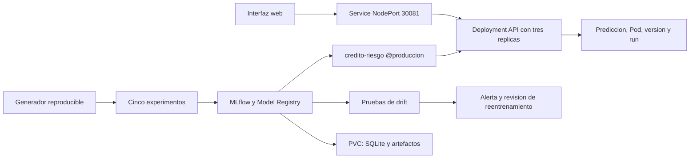

# Arquitectura de riesgo crediticio

Autor: Aldair. Modalidad individual. Ejecución verificada el 4 de noviembre de 2026.

## Problema y datos

El servicio clasifica solicitudes de crédito como cumplimiento o morosidad simulada.
Se reutiliza la regla generadora del proyecto base de clase, con 3.000 filas y cinco
entradas. Hay 854 positivos (28,47 %). Ingreso, deuda, antigüedad y monto se comparan
como variables numéricas; el plazo tiene siete valores discretos. La semilla es 42.

Los datos sintéticos permiten alterar entradas y etiquetas por separado y repetir
el experimento sin datos personales. La consigna recomienda un dataset público,
pero no lo exige. La limitación es que este resultado no demuestra capacidad de
predicción en una cartera real. No se usa para otorgar créditos.

La división estratificada fija contiene 1.800 filas de entrenamiento, 600 de
validación y 600 de prueba. Las particiones no se solapan. El baseline es solamente
entrenamiento. Se conserva el hash del dataset y la lista de índices de cada
partición como artefactos de MLflow. La huella del dataset es
`d42968756987d6404bed20556d904651e01551660f402687c427dd96fe1a645f`.

## Componentes y flujo

MLflow 2.22.2 se ejecuta dentro de Kubernetes y expone su interfaz en
`http://localhost:30500`. Su base SQLite y sus artefactos están en un PVC de 2 GiB.
El servidor sirve también los artefactos por HTTP; las réplicas no comparten una
ruta de archivos local con el entrenamiento. La API accede a `http://mlflow:5000`
mediante el Service interno.

La API recibe `MODEL_URI=models:/credito-riesgo@produccion`. Al arrancar, consulta
el alias y resuelve una versión inmutable del registro; después descarga esa
versión mediante MLflow. Esto evita que un cambio concurrente del alias mezcle
la versión declarada y el modelo cargado. No hay `joblib.load` ni un modelo
preentrenado copiado manualmente al Dockerfile. MLflow realiza la serialización.

Cada respuesta de inferencia incluye `moroso`, `probabilidad`, `modelo_uri`,
`version_modelo`, `run_id` y `pod`. Mover el alias no cambia los procesos ya
arrancados: una promoción requiere un reinicio gradual del Deployment.

## Experimentos y modelo elegido

Se ejecutaron cinco Random Forest con la misma división, semilla y umbral 0,5.
Se eligió F1 de la clase morosa porque accuracy puede ocultar errores de la clase
minoritaria. La selección usa validación; no compara hiperparámetros sobre prueba.

- bosque-1: 80 árboles, profundidad 4, hoja mínima 5; F1 de validación 0,6090.
- bosque-2: 120 árboles, profundidad 6, hoja mínima 3; F1 de validación 0,6597.
- bosque-3: 150 árboles, profundidad 10, hoja mínima 1; F1 de validación 0,6667.
- bosque-4: 150 árboles, profundidad 6, hoja mínima 3, pesos balanceados; F1 0,7025.
- bosque-5: 200 árboles, profundidad 10, hoja mínima 2, pesos balanceados; F1 0,7009.

Se registró bosque-5 como versión 1 y bosque-4 como versión 2 del nombre estable
`credito-riesgo`. El alias `produccion` apunta explícitamente a la versión 2.
Su run es `1e80a5489e3d4a4c82e58d10baf530d6`, asociado al código de entrenamiento
del commit `3d42a55`. En prueba obtuvo F1 0,6756, accuracy 0,7983, precision 0,6238
y recall 0,7368. El entrenamiento del modelo servido utiliza las 1.800 filas
originales; no se reentrena silenciosamente con validación o prueba.

La ventaja F1 frente a bosque-5 es pequeña: 0,00164. No se afirma superioridad
estadística. Bosque-4 cumple el criterio declarado, recupera más positivos en
validación y utiliza menos árboles. La defensa incluye ordenar por `val_f1`,
filtrar `metrics.val_f1 >= 0.70` y comparar ambos runs en la interfaz real.

## Contenedor y despliegue

La imagen propia es `credito-mlops:1.3`. Usa Python 3.11.11 slim con digest fijado,
dependencias directas en `requirements.txt` y todas las dependencias resueltas en
`requirements.lock.txt`. Se ejecuta con UID 10001. El servicio arranca con Uvicorn
sin instalar paquetes ni entrenar al atender peticiones. Requiere que el registro
MLflow configurado esté disponible al iniciar, como indica el manifiesto.

El Deployment tiene tres réplicas, solicitudes de 100m CPU y 256 MiB por réplica,
y límites de 1 CPU y 768 MiB. Incluye startupProbe, readinessProbe y livenessProbe.
El Service usa la etiqueta `app: credito-api`, sin afinidad de sesión. La estrategia
gradual permite cero réplicas no disponibles y una adicional durante una actualización.
Un preStop de cinco segundos permite retirar el endpoint antes de cerrar Uvicorn.

El balanceo se comprueba con solicitudes a través del NodePort, no mediante
`port-forward` hacia un Pod. Las conexiones independientes permiten observar
el reparto de capa 4. `/health` cierra la conexión HTTP para que el navegador
pueda mostrar distintos Pods en la demostración de doce solicitudes.

Se verificaron tres Pods Running, 30 inferencias HTTP 200 repartidas 8/9/13,
respuestas válidas de bajo y alto riesgo y rechazo HTTP 422 de un ingreso negativo.
Al eliminar `credito-api-9674b6c78-fjg4m` apareció
`credito-api-9674b6c78-5cgx2`. Las 52 inferencias muestreadas durante esa prueba
respondieron HTTP 200. Se escaló de tres a cinco y se regresó a tres.
Esto demuestra recuperación en la ventana observada; no constituye un SLA.

## Data drift

Cada una de las cinco entradas se compara contra el baseline de entrenamiento.
Para las cuatro variables numéricas se usa KS de dos muestras, que detecta cambios
en la distribución sin suponer normalidad. Para el plazo discreto se usa una tabla
de frecuencias con chi-cuadrado y distancia total de variación; no se aplica KS
como si el plazo fuera una variable continua. Se revisan las frecuencias esperadas;
un lote insuficiente, valores no finitos o categorías demasiado escasas requieren
una revisión de calidad o esquema.

Se alerta cuando p < 0,01 y el efecto supera 0,10. El 0,01 proviene de dividir
el nivel familiar 0,05 entre cinco variables mediante Bonferroni. El efecto mínimo
exige una diferencia de al menos diez puntos de probabilidad acumulada para KS,
o 0,10 de variación total para plazo. Es un criterio operativo didáctico para
evitar alertar por diferencias pequeñas, no un umbral universal.

El control usa 1.000 filas nuevas de la misma regla generadora y semilla 2026.
La deriva deliberada modifica las cuatro variables numéricas y concentra los
plazos en 48/60 meses. El control queda VERDE y la deriva ROJO en las cinco
variables. La puerta de calidad devuelve códigos de salida 0 y 2 respectivamente.
Los tests automatizados pasan porque verifican que la deriva sí es detectada.

Con los umbrales ya fijados, cien lotes independientes de 500 filas (semillas
5000 a 5099) produjeron cero falsas alarmas observadas. Este control no garantiza
ausencia de falsas alarmas futuras. El tamaño mínimo aceptado por variable es 100.

## Concept drift y etiquetas retrasadas

Se utilizan diez lotes contrafactuales pareados con las mismas 1.000 entradas;
solo cambia una fracción de etiquetas: 0, 0, 0, 10, 20, 35, 50, 65, 70 y 70 %.
No son diez días de producción real: representan un orden temporal simulado
que aísla el cambio de P(y|X). El detector de entradas se mantiene VERDE.

Se mide F1 con las nuevas etiquetas. El valor inicial es 0,6893 y el del lote 10
es 0,3013. La referencia reservada de prueba es 0,6756. Se pide revisar el
reentrenamiento cuando la caída absoluta supera 0,10 durante dos lotes etiquetados
consecutivos, es decir, F1 < 0,5756. La primera alarma ocurre en el lote 6.
Los diez puntos representan una pérdida operativa considerada relevante para esta
práctica; exigir persistencia reduce la reacción ante un solo lote desfavorable.

En producción, el impago real llega semanas o meses después. Mientras falten
etiquetas se controla esquema, distribuciones, tasa de predicciones, errores y
latencia. Un lote sin etiquetas queda PENDIENTE_ETIQUETAS: no se calcula F1 ni se
declara que el concepto sigue estable. La ausencia de data drift no descarta
concept drift.

Para producción se propone conservar un identificador de predicción, fecha,
versión/run y el resultado posterior, unirlos al madurar la etiqueta y evaluar
cohortes comparables, con cobertura y retraso de etiquetas. Ese almacenamiento y
la integración con una cartera real no forman parte de esta demostración.
La alarma implementada solicita revisión; no sustituye automáticamente el modelo.
Un reentrenamiento requeriría datos recientes etiquetados, evaluación del candidato,
registro de otra versión y promoción controlada con posibilidad de reversión.

## Observabilidad y límites

La capa técnica expone `/health`, `/ready`, `/metrics`, contadores HTTP por estado
y un histograma de latencia; los logs JSON identifican Pod, versión y run sin
registrar las solicitudes financieras. La capa de modelo conserva pruebas por
variable, curvas de F1 y alertas como artefactos del run desplegado. Una métrica
de negocio real no puede medirse con esta población artificial.

El clúster local tiene un solo nodo. Las réplicas toleran la caída de un Pod;
no toleran la pérdida del nodo o de Docker Desktop. MLflow usa una instancia
y SQLite por simplicidad del laboratorio, por lo que no tiene alta disponibilidad.
Las réplicas ya cargadas pueden inferir si MLflow cae, pero nuevas réplicas no
pueden arrancar. Una operación real requeriría varios nodos, un backend de base
de datos y artefactos compartidos, controles de acceso, respaldos y validación
de sesgo, privacidad y desempeño con datos representativos.

## Reparto individual

| Integrante | Componentes realizados | Evidencia |
|---|---|---|
| Aldair | Datos y entrenamiento reproducible | src/datos.py, src/entrenar.py e historial Git |
| Aldair | MLflow y registro del modelo | k8s/01-mlflow.yaml y dos versiones registradas |
| Aldair | Docker, API e interfaz | Dockerfile, requirements.lock.txt, src/api.py y src/interfaz.html |
| Aldair | Kubernetes y verificaciones | k8s/02-api.yaml y scripts/verificar_cluster.py |
| Aldair | Drift, pruebas y documentación | src/drift.py, tests, docs y presentación de defensa |

El material base de la clase se reconoce como punto de partida; el reparto no
atribuye la autoría del material docente al estudiante. Los commits usan la
identidad Git configurada, mensajes breves y fechas reales de trabajo.

## Referencias

- Material entregado por el docente: proyecto-base 2.zip; drift.zip;
  heladeria-ci-cd-ct.zip; Clase 7 - Diapositivas.pdf; Clase 7 - Infografia.png.
- MLflow, Model Registry: https://mlflow.org/docs/latest/ml/model-registry
- MLflow, alias y carga de versiones: https://mlflow.org/docs/latest/ml/model-registry/workflow
- MLflow, servidor y almacenamiento: https://mlflow.org/docs/latest/self-hosting/architecture/tracking-server/
- SciPy, KS: https://docs.scipy.org/doc/scipy/reference/generated/scipy.stats.ks_2samp.html
- SciPy, chi-cuadrado: https://docs.scipy.org/doc/scipy/reference/generated/scipy.stats.chi2_contingency.html
- Kubernetes, Deployments: https://kubernetes.io/docs/concepts/workloads/controllers/deployment/
